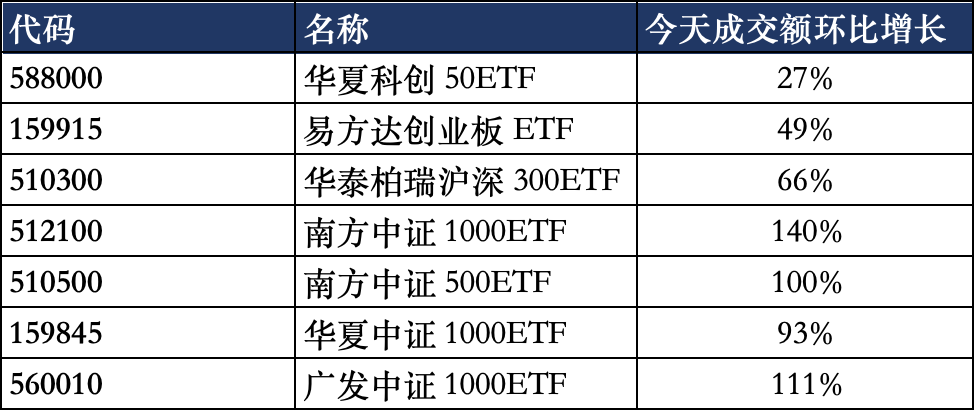
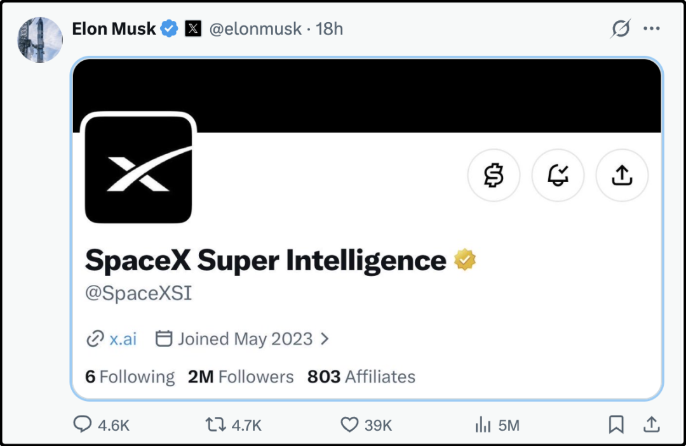
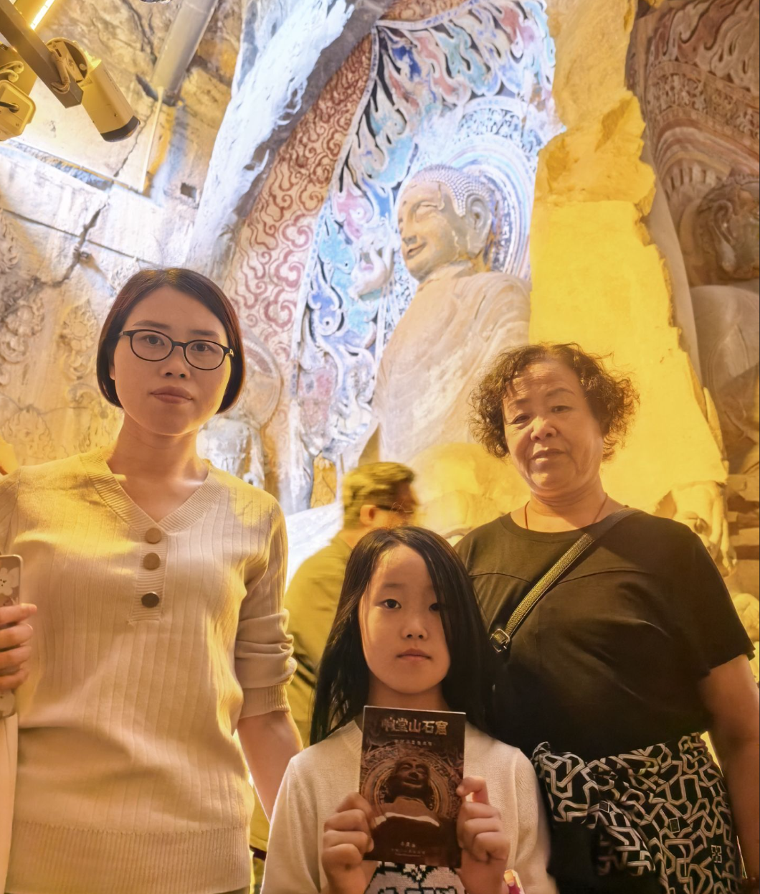

# 少200亿要命了

明天又要开盘了，把重要的信息捋一捋吧。

1、先给周五简单复盘，周五先跌后涨深V翻红，舆情关注的焦点是上午的交易时段宽基ETF的成交旺盛，有多只ETF半天的成交规模接近或者超越周四，媒体报道的过程中给人一种暗示，是有大资金入场抄底才导演了日内行情翻转。

成交量暴增是客观数据，到底有多少增量资金抄底ETF目前不清楚，要T+1日，周一收盘后才知道。我觉得股民要理性看待国家队资金在a股的角色，它们不是救世主，它们可能有的时候承载着避免市场过大波动，防止系统性风险的任务，但最终目的肯定还是赚钱，低吸高抛是常规操作。还有就是不要因为官媒说过要做耐心资本，认定国家队买了就10年20年不卖，炒股还是自己多长心眼，独立思考。记住，你是你钱包的唯一责任人。

虽然周五行情反弹逆转，但并没有改变近期下跌的趋势，包括上证50、沪深300、中证500、科创50、创业板指都在创7月份调整以来的新低，下周依旧承压。截至周五收盘，除科创50外的所有主要宽基年内都已经转跌。

个别回撤大的，比如创业板指，70个交易日跌了30%，早就进入技术性熊市了。

2、最近美股科技圈为了200亿的数字争论不休。事情的起因是openai宣布截至9月底，已经达到了年化营收500亿美元，然后就有人站出来说此前市场预期是700亿美元，openai这波业绩暴雷了。openai随后说到了年底（12月份），预计可以达到年化700亿美元。

这里要先解释一下年化营收，该指标是根据最新一个月的收入乘以12倍算出来的，比如9月份营收40亿，那就宣布自己年化营收480亿，如果12月份营收有60亿，那乘以12就700亿了。

传统行业没有这么算账的，年化营收这个概念只限于ai圈，主要是因为ai行业的变化太快，anthropic一年半的时间估值涨30倍，静态pe或者动态pe估值都太滞后，所以大家都按最新一个月的数据来计算年化营收。

ai商业化目前冲最前面的是anthropic和openai两家，它们一旦营收增长乏力，就会放缓基础建设，到时候整条产业链都会受冲击。anthropic年底预期年化1000-1100亿美元，openai年底预期年化700亿美元，记住这两个数字，要是年底miss了少不了一顿毒打。

3、10月9日美国正式立案337调查，起因是美国电源厂商Vicor起诉工业富联、立讯精密、台达电子（台湾上市公司）、英飞凌（德国上市公司）等企业，指控其AI服务器垂直供电系统（VPD）侵犯专利。

337调查一旦认定侵权，会禁止相关产品进口美国，不直接罚钱。立讯精密和工业富联都回应了，大致意思是涉案产品尚处在客户验证阶段，暂未大规模出口，短期业绩冲击有限。Vicor这波操作其实是预防性的，防止中国产的ai服务器电源进入美国市场。

4、人民日报文章：四部门联手对“速成车”说不。什么是“速成车”，专指为了抢占市场份额，过度压缩研发周期，删减实车验证流程而推出的车型的统称。“有的品牌为了追求上市速度，很多该做的实验没有做，消费者成了‘试车员’。”

文章里还点名了尊界V800，所以就算厂家能量大可以压下网络热度，但是官方层面对这件事的定性依然是很坚决的，相关负面影响会持续很久。

今天我在网上还看到一个吐槽，说现在宁德时代有电池和底盘都有集成好的，现成的，你新成立一个品牌，只要在底盘上装5张座椅，套个外壳，就能拉出去卖了。

5、特朗普最近一直在努力推进一件事，就是把ai改成si，从人工智能改成超级智能。特朗普解释这么做的目的是纠正大家的认识，人工智能听起来自带 “虚假、仿造” 负面暗示，叫超级智能则能排除歧视推进产业发展。

马斯克积极响应了这一号召，10月10日把spaceai改成了spacesi。这让我想起了昨天文章里提到的安圭拉岛，他们因为域名一年白赚9000万美元，如果后面大规模向si域名迁移的话这笔钱就没了。大人物随意之间一个闪心动念，可能会影响一大群人的祸福。

昨天有人留言说这会不会是一个阴谋，因为特朗普老婆是斯洛文尼亚人，而斯洛文尼亚的域名后缀是.si，我觉得不至于，因为这个利益盘太小了，满打满算也就几千万美元，能分润给特朗普的没几个钱。

6、日经亚洲消息：苹果通知供应链下调iPhone18 Pro零部件订单，10 月订单较最初规划削减 15%-20%，市场解读为新机需求偏弱。原因可能是最近存款涨价推动产品涨价，从而抑制了消费需求。其实不单单苹果涨价，国产手机最近也普涨500-1000元，这其实就是普通人在变相的为ai发展付费。你可以忍一忍，手里的手机咬咬牙再用2-3年，到时候内存价格应该就下来了。

今晚就这些吧，最后更一个女读者带着妈妈、女儿出游的照片，邯郸响堂山石窟。

“这次中奖太惊喜了！十一带着妈妈和女儿一路往东南走。邯郸响堂山石窟的石阶上留下了祖孙俩的脚印，广府古城的灯光把水面映得碎金闪闪。江苏连远港海边的小螃蟹，成了女儿一路念叨的小惊喜；海上云台山的风把海和天揉成同一种蓝。第一次带妈妈出门，看着妈妈和女儿都笑得眼睛弯弯，心里软乎乎的全是满足。”

今晚就这些，发了。

作者: 猫笔刀

查看原文 →
