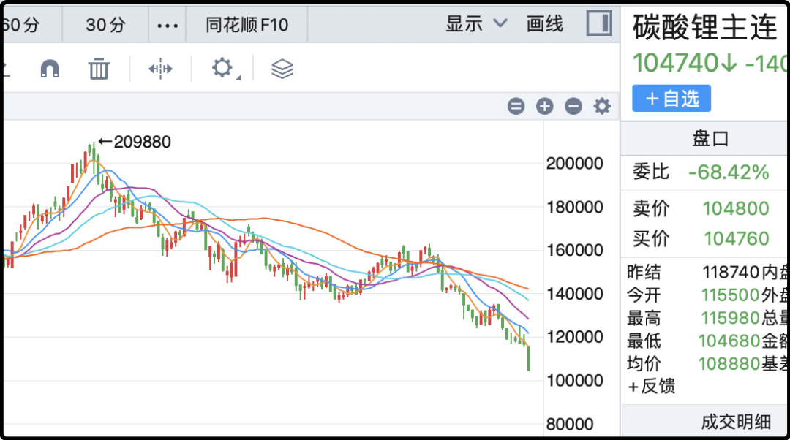

# 终于还是暴雷了

今天白天看到朝阳公安局的蓝底公告，依法对宜信相关公司涉嫌违法犯罪立案侦查，已经实际控制唐某（男，53岁）、赵某（女，51岁）等多名犯罪嫌疑人，采取刑事强制措施。然后就是通知受害人进行多种形式的报案。

这里的唐某说的是唐宁，赵某应该就是他的妻子赵玫，夫妻两都被刑控了。我看了以后太感慨了，我2011年出来创业，公司当时融到了300万的天使投资，其中150万就是唐宁投的。那一年宜信如日中天，是国内p2p贷款的行业龙头。

现在很多人一听p2p就自动和庞氏骗局划等号，但宜信是真的有做业务，他们以10-12%的收益率募集资金，然后再以27-39%的利率借给个人和小微企业，盈利模式就是赚中间的息差。

你可能一看30%以上的利率都惊了，像是非法高利贷，但其实这个利率是市场价，因为来借钱的人征信都很差，坏账率高（10-15%），去正经银行根本借不到钱。借给他们钱只能用高息覆盖高坏账。

后来国家对民间借贷进行了规范，利率上限被压到了24%以内，宜信的操作空间就变小了。等到这几年经济下行，坏账率暴发，宜信终于撑不住了。今年5月的时候宣布良性退出，我当时就知道糟了，前几年那些自称良性退出的平台几乎无一善终。

昨天宜信给客户发信道歉，说资不抵债，偿债缺口大，停止兑付，实质违约。

今天朝阳公安就立案抓人，这其实也是行业惯例，老板如果还有操作空间，能推动兑付还钱的，执法机关只会边控你，保留你在国内自由，把摊子撑起来，同时也是稳住客户，维护秩序。一旦老板已经无计可施，山穷水尽，就会抓人进去走清算流程。

对于大量投资人来说这当然不是好消息，根据媒体的估算未兑付规模在300-500亿，这背后有数以万计的投资者陷在其中。之前有个读者给我的公众号留言，他家买了3000多万，家里的流动资金都投进去了，我听了以后真的心情很沉重。

我们家以前也买了很多宜信产品，但2019年后陆陆续续到期就退出了，因为从那个时候起宜信的经营就开始走下坡路。民间借贷，尤其是低征信的垃圾贷在中国不好做，政府禁止高利贷，还对催收严格限制，这门生意已经被挤到死胡同了。

至于唐宁投资我们公司的股份，2020年退出了，我们按市场利率结算本息回购了股份，很感谢他在创业初期提供的帮助。曾经我觉得宜信是一个很有前途的公司，唐宁是很有能力的企业家，他是北大数学系的，没想到最后是这个结局，太让人扼腕了。

……

话说相比起买理财暴雷，血本无归，你们是不是觉得炒a股亏个20%、30%也没那么痛了，a股虽然坑爹，但没有底层信用风险，它会钝刀子割肉，但不会釜底抽薪直接给你干没了。

今天a股又扑街了，成交量低迷才1.5万亿左右，但就这么点量也能砸出中阴，中位数下跌1.73%，各大指数也跌了差不多2%。科技板块血流成河，可以把锅甩给韩国股市，今天三星和海力士都跌了4%，但这哥两上半年疯涨的时候咱们也没跟上。

今天我看了某券商的研报，里面提到多家险资在二季度的时候追高了科技板块，险资对风控的要求是很严格的，一旦遇到大幅回撤或者巨额赎回只能刚性斩仓。

我看完研报后有一个好消息和坏消息要告诉你们，好消息是险资已经割肉七八成了，坏消息是还有两三成要割肉

科技板块血崩倒是对传统行业有利，今天金融逆势上涨，银行+2%，保险+0.4%，券商+0.1%，避险属性拉满了，另外前期人见人踩的白酒消费也有资金回流，茅台在这个泥沙俱下的日子里也涨了2%。

接下来市场本质上就看一件事，科技行情是否已经熄火，要是科技彻底玩完，那像沪深300、双创、中证500/1000这些指数都不会好的，因为它们里面的权重早就都替换成了科技股。反而像上证50这种含科量低，前期表现弱鸡的指数反而会反向获利。

那科技行情结束了吗？在眼下这个时节我看法偏负面，至少像去年6月到今年6月那种全面逼空的行情不会有了，可能个别细分赛道还有资金折腾一下，但也很难炒了。中证500指数关注一下6900-7000的支撑，这里没顶住的话做好去6500的准备。

……

1、今天碳酸锂期货暴跌12%，锂矿板块也暴跌。话说高盛在5月上旬看空看的挺准，说完见顶就崩了，你们应该有印象。这让我对他们后续的看法产生了兴趣，我搜了一下研报，他们认为接下来产能过剩超过20%，未来两年价格逐年下跌，碳酸锂明年均价10万，后年均价8.4万，又要在泥潭里挣扎好几年。

2、红果短剧海外版下载量突破1亿，日活用户将近700万，字节系太擅长制造精神成瘾的产品了，不但牢牢抓住中国用户，翻墙出去也随便拿捏老外。美国模型的token消耗量最大的场景是写代码，中国模型的token消耗最大场景是ai视频，因为生产出来短剧马上就能赚钱。今天传媒板块集体大涨，但这纯属情绪性的，就a股传媒板块那些个歪瓜裂枣根本就没什么东西，他们能涨只是因为大家买不到字节的股票。

3、乘联会公布了最新一个月数据，我懒得一个一个贴过来了，简单说就是国内同比滑坡2-3成，电车小滑，油车屁股沟都露出来了，但是对外出口大增，稳住了销售市场。欧洲现在是重要销售市场，我们和欧洲的关系很重要，目前两国部长正在谈判，有进展有成果，但依然很矛盾。

今晚就这些吧，上钟咯。

作者: 猫笔刀

查看原文 →
