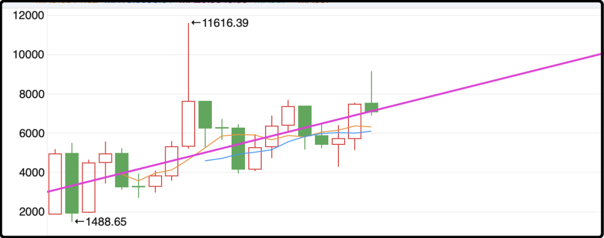
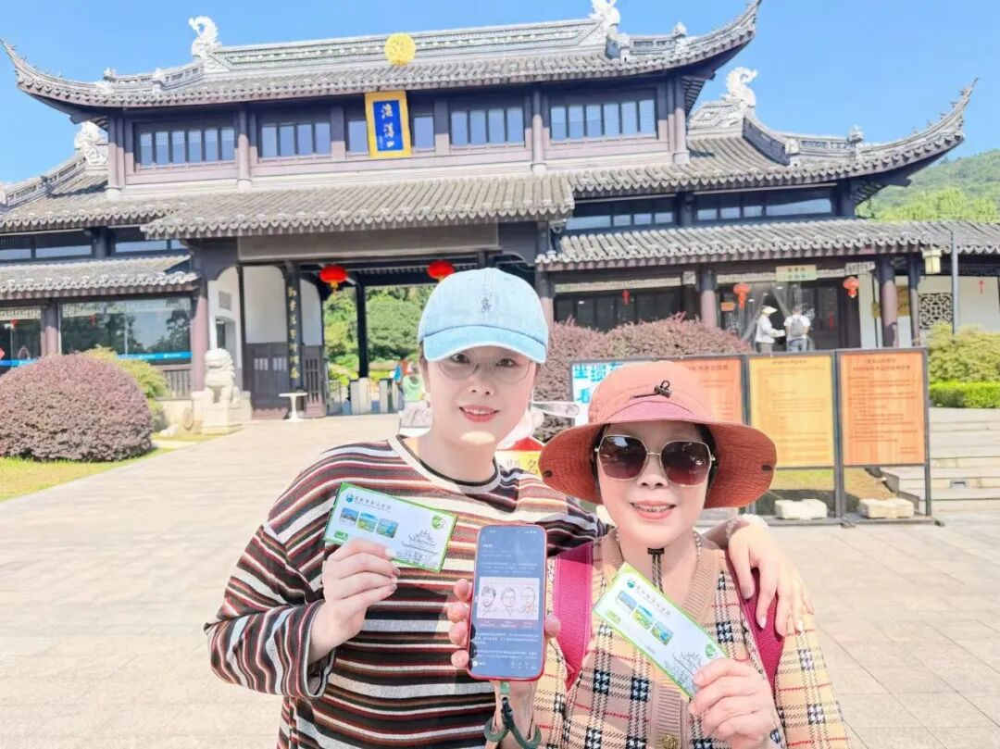

# 温水煮蛙

昨天写了宜信暴雷的事，很多读者不理解p2p倒闭潮快10年了，为什么还有人敢投资宜信。事实上他们从2019年之后就转型财富管理了，尝试合规化，但底层的商业逻辑还是和以前差不多的。自己不是银行，然后做传统银行不愿意做或者做不了的那部分息差市场。

对于投资者来说，他们其实对底层并不了解，他们能感受到的是宜信是大公司，宜信开了快20年了，宜信之前没赖过账，宜信保本保息，给的收益率也还行。

我了解过他们的固收类产品（瑞承）的收益率也没有高到很离谱，前两年还有6-7%，去年只有5-6%了。银行这几年持续降息，理财产品收益率跌的都没法看了，很多存钱的人都有理财焦虑，隔三差五有人来我的评论区问有没有风险低，年化5%的理财。

他们心理预期还停留在七八年前，不愿面对现实，这样的人一旦了解宜信的渠道就会很有兴趣投资。其实很多人刚开始投资的时候也知道分散风险，但过程中不断有其它渠道的产品到期后，收益率下调，6%、5%、4%、3%、2%……一路走低，低到没法看，难以接受，就会把这部分资金调出来加仓到收益率还可以的渠道，最后单一重仓爆掉就是灭顶之灾。

我之前说过很多次了，这几年是去杠杆周期，高净值家庭理财时优先考虑信用风险，至于权益波动，或者收益率低点都能忍。你1000万亏30%，700万也还是有钱人，要是本金没了你就要滚去下一个阶层了。

……

今天a股上来就很吓人的跳空低开，因为昨晚美股科技板块小崩，费城半导体指数跌2.67%，存储、光通信硬件杀跌，市场又开始质疑AI资本开支回报低，博通CEO发声AI板块过热，一波小范围恐慌抛售。

然后情绪传导到今天早上开盘的亚太股市，韩股开盘暴跌，盘中最大跌幅超过7%，三星电子、SK海力士血崩，日经225同步大跌，软银、铠侠重挫。

就是在这种背景下，a股开盘就-2%，10点之前一度扩大到-3%，不过这次a股顶住了，午休前发动反弹一波冲上岸。a股确实有这个特性，大幅高开基本都是低走，大幅低开往往能韧性反击，我之前也琢磨过这事，怀疑和t+1的交易制度有关。

弹的最多的当然是科技ai，今天PCB板块密集出了超预期的三季报，抄底资金就是从这里吹响反攻号角。从上午的坑底到下午收盘，科技ai个股普涨3-4%，现在各大指数里科技股的权重都很高，所以收盘的时候指数基本上都回来了。

今天反弹这一下很大程度上缓解了市场恐慌，很多抱头鼠窜的资金给了一口喘息的时间，正好休息一晚镇定一下心神，思考一下还要不要在这个位置继续杀跌。

有人问我现在算不算熊市，我觉得不算，可以确定去年夏天到今年夏天的这波科技牛市已经熄火了，但a股整体上处于波动区间中枢附近，不贵也不便宜，不牛也不熊。目前这个位置远没有体现熊市的残酷，我不确定后面会不会继续熊，但如果熊的话一定比现在糟糕的多，我说这话的目的是提醒诸位做好后撤余量，或者时髦一点的词叫【增加安全冗余】。a股远没到退无可退的程度，你别一激动先把自己的刹车踩断了。

……

1、今天尊界汽车发布了一家三方机构的测试，测试结果一大堆专业术语我也不太懂，但大致意思就是刹车没问题，符合国标，消息一出江淮汽车大幅反弹9%。但随后市场情绪出现反弹，大家质疑这次测试的环境和懂车帝视频里的测试环境不一样，说白了还是懂车帝视频里的情况更容易让公众理解，100公里时速+全力急刹，刹车连断3个。

这有点像之前西贝的争议，贾国荣觉得按照国家标准自己的菜不是预制菜，但去西贝吃饭的不是国家标准，是一个个具体的消费者，消费者的主观感受如果和国家标准出现偏差，你们说以谁为准呢...

2、今天全球很多媒体都报道哈萨克斯坦央行因为黄金比例过高（78%），打算四季度减持到75%。我还特地去查了一下，他们储量大概386吨，如果减仓的话要卖14-15吨，而中国央行连续23个月增持，上个月买了23吨，轻松就能兜住。大概是黄金空头实在着急，想借哈萨克斯坦的锤子敲打一下金价。黄金短期内最低也就看到3800-4000，除非美元加息的预期再有重大调整。

3、deepseek即将完成1000亿元的融资，整体估值还是之前的5000亿。这一轮融资可以在一定程度上稀释梁文峰的持股比例，他现在80%实在太高了，要把筹码散出去，这样在推进上市的过程中会得到更多力量的支持。话说还没上市就5000亿，这要上了a股真就要奔着2万亿去了。

4、海底捞公司向CEO张勇提供1亿元贷款融资，期限30天，这估计还是跑步补税，哪哪还差一点。不敢再卖公司股票了，他套现1亿，公司市值能跌几十亿。港股的流动性在全世界都有口碑了现在。

今晚就这些吧，附一个读者带母亲出游的反馈，她就是那位单亲妈妈，我临时决定在评论席多捞一个的额外中奖者。

“这次有幸中奖，带着母亲和儿子自驾来到苏州太湖，完成了这场珍贵的陪伴之旅。陪着长辈慢慢逛，一家人同行的时光格外温暖治愈。这次旅途充实又开心，圆了我带家人出游的心愿。感恩活动，愿大家都能拥有和家人相伴的美好旅程。也感谢我自己，第一次开高速带他们自驾游，顺利，成功！”

上钟咯～

作者: 猫笔刀

查看原文 →
