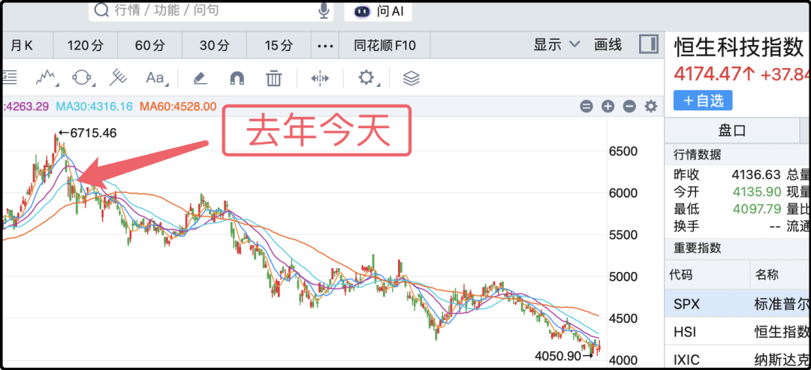
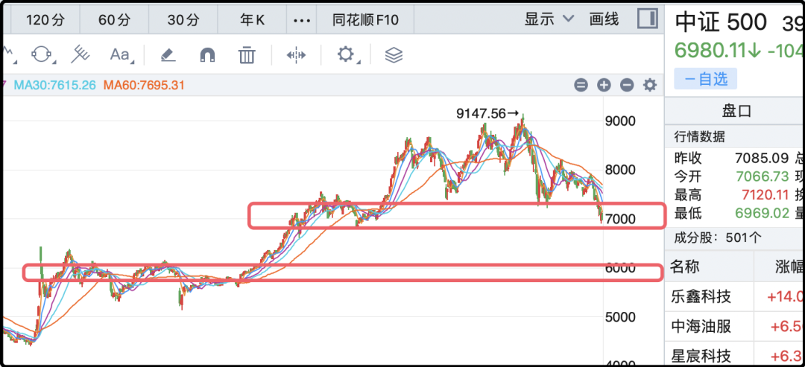
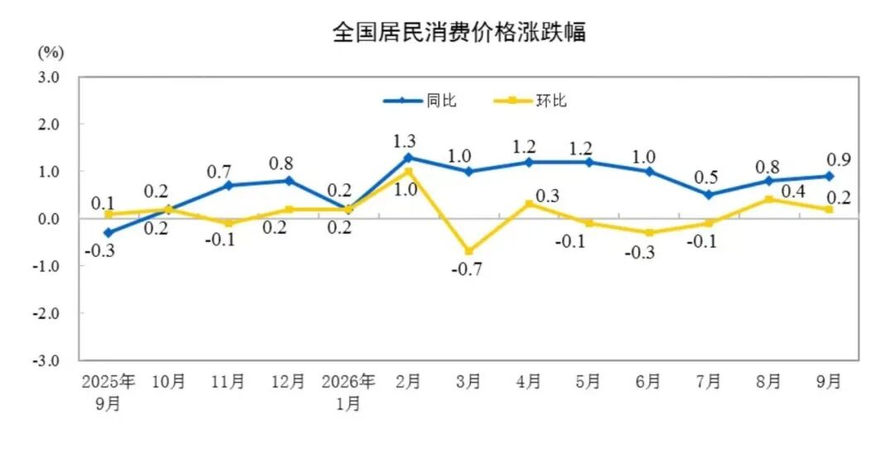
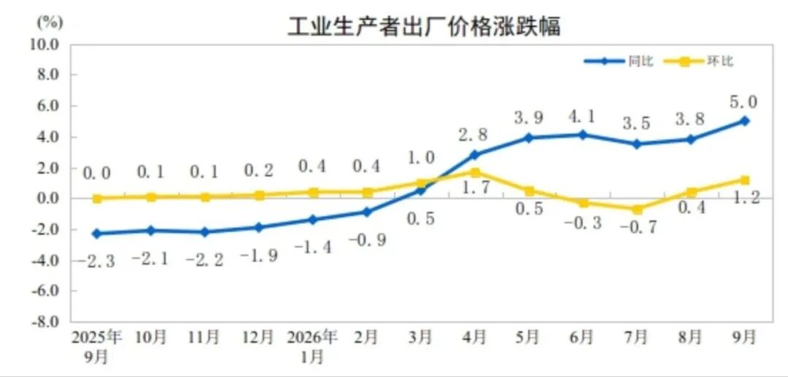
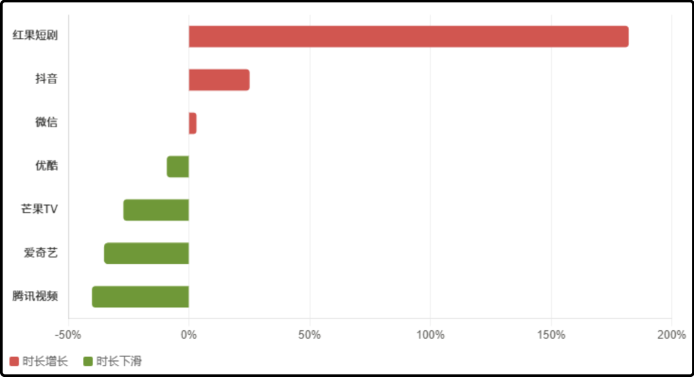

# 人心都跌散了

一年前的今天，你如果拿100万去投资韩国kospi指数，现在是168.7万，如果去投资日经225指数，现在是144.6万，如果去投资台湾加权指数，现在是181.5万，如果投资纳斯达克100指数，现在是124.4万，如果投资沪深300指数，现在是92.9万，没有盈利，倒亏7.1万。

选择大于努力，这句话的含金量能听懂吗。其实投资沪深300还不算是最糟糕的选择，如果你投资恒生科技指数，那过去这一年要亏29.5万，还剩70.5万。根本不创造财富，纯吃人的市场，说一句谋财害命不过分。

别看人类全面进入了ai时代，但其实世界上大多数国家和地区并没有发展ai相关产业，真正处于第一集团的就是中美两个国家，至于日本韩国以及岛省，都是上下游做供应链生意的。照理说这样的产业地位，应该孕育强大的科技板块，推动资本市场走出漫长的熊市。

但结果是中国ai产业欣欣向荣，一会这个企业上市估值上万亿，一会那个年轻企业家荣登富豪榜，中国模型日新月异，又便宜又好用，性价比领先全球，看起来是这里赢那里赢，唯独股市没让股民赢。

说实话有些失望，总以为这次不一样，但最后都一样。a股还是那个糊不上墙的烂泥，每年承受巨大波动却只给年化5%的收益，性价比真的好差，但目前国内你也找不到其它投向，房子不敢买，银行存款1%出头，债券收益2%左右，垃圾债一不小心本金就炸了，外面的市场出不去，墙上的洞全给堵上了。兜兜转转看了一圈，你叹了口气最后还是会留在a股继续玩

……

今天a股成交量缩到只有1.41万亿，但依然给市场造成了显著杀伤，指数全绿，中位数跌2%。中证500收盘6980，跌穿了7000关口，好像是一两个星期前7400那会，问过ai跌破7000点的概率是多少，加权平均算下来概率是47%，现在47%变100%了。

6500-7000是我会认真考虑ic加仓的区间，但现在趋势不好我会谨慎一些，我要再看看，起码确认跌势已经稳住了再说。我去年在7400减了1/3的仓位，现在等了一年时间，算上贴水的话其实也没赚。本来我如果执行最初的计划就能在9100点全部清仓，可惜中途改主意了，说出来挺滑稽，我当时相信a股会改，为这个相信支付了700万的代价。

已经过去的事情无法改变，接下来是要专注后面的行情。中证500指数在左边上来的时候搭建过两个整理平台，分别是2025年8月-12月在7000点附近的平台，以及2024年9月-2025年6月在6000点附近的平台，这两个平台都能提供一定的支撑性。

别看今天收破7000，但并一定算有效突破，乐观点看未来几天依然有支撑反弹的概率，没发生的事终归是不确定的。但你在风险控制的时候不能把底线定在7000，要有情况继续恶化的应对预案。

我认为未来一年内跌到6500的可能性大概是35%，跌到6000的可能性是20%不到一点，仅为我个人当下最新感受。

……

1、最新一个月的cpi（全国居民消费价格）公布了，环比涨0.2%，同比涨0.9%，这个数字一般，离政府目标还有相当距离。不过ppi（工业生产者出厂价格）倒是涨挺好的，环比+1.2%，同比+5%，看起来已经好起来了。我把cpi和ppi的走势图贴一下你们看。

那为什么ppi涨了快半年，cpi没有涨呢。因为ppi是输入端上涨，说人话就是成本涨了，主要原因是国际油价，有色金属，煤炭这些大宗商品涨了，叠加“ai通胀”，芯片和存储器涨价，所以导致ppi上涨。但老百姓消费这一块的需求并没有跟着上涨，所以就出现了两个数据的剪刀差。如果明年大宗商品价格回落，或者ai热度下降，ppi不但没把cpi拉起来，大概率自己回落向cpi靠拢。

2、腾讯刚官宣新一轮全球中期票据融资，融18亿美元，10年期的6.1%利率，20年期的6.75%利息，另外融260亿离岸人民币，这个利息低一些，10年期的2.4%，30年期的3%。腾讯最近在ai上的支出陡然增加，这么好的先进奶牛现在也有些手动紧张，但它的信誉很好，人民币融资成本低，至于美元目前利息确实高，回头等降息了用新债替换旧债。

3、今天a股少数几个上涨的板块里主要是影视传媒和游戏，但其实市场真正追捧的是ai短剧这个赛道，只不过买不到正宗标的，只能在a股勉强东施效颦。根据机构研究数据，红果短剧正在疯狂吸收互联网用户的时长，甚至人均已经超过了抖音。

人一天只有24小时，这里吸的多了，别的地方的时间就少了，传统长视频网站“失血”严重。今天热搜一个话题在讨论，看红果短剧会不会降智。我这段时间也在观察短剧内容，我自己也下载了红果，早期短剧通常还会构思比较有趣的剧本，现在则要简单粗暴的多。

通常就是凭空捏造一个生活中不太可能存在的极端人物，比如办公室同事捡到我的会员卡，被我发现了，我提前悄悄把卡注销了，这个同事突然邀请全部门同事去胡吃海喝，想用我的会员卡请客，一顿饭吃了10万。最后发现卡无法付账就现场崩溃了。

现实中我没见过这么离谱的人，但这种疯狂打脸煞笔的剧情看起来莫名的爽，剧本很容易写，给我半小时我就能复制一个差不多的，让ai可能5分钟就给你出100个。拿着剧本再找ai制作，一条流水线，就能反反复复的让网民看着爽，爽了一遍又一遍。

这种剧看多了会不会降低智商我不清楚，但肯定浪费时间，只是社会上普通人的时间不值钱，能拿来兑换这种廉价的快乐他们愿意。不是每一个人都要持续进步的，有人愿意躺平，有人愿意滑落，他人无权干涉。

今晚就这些吧，上钟咯。

作者: 猫笔刀

查看原文 →
