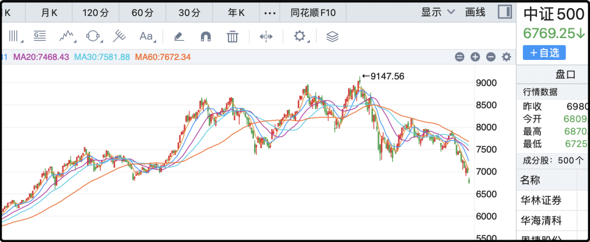
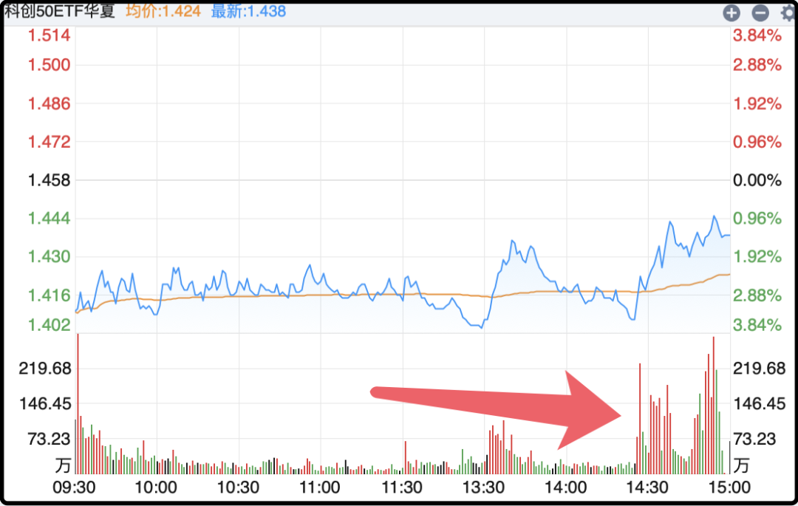
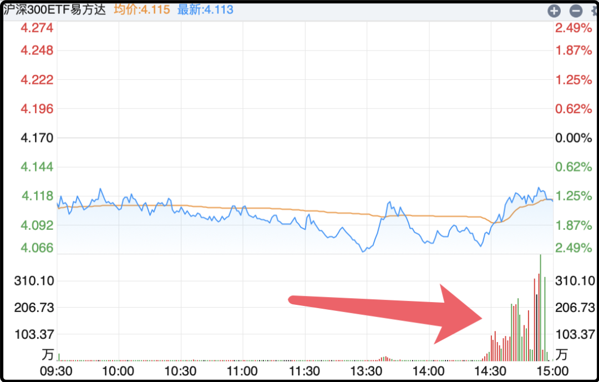

# 最后半小时买了将近500亿

昨晚文章发出来不到半小时没了，很多读者没看到就会好奇，四处打听，还有让我以其它形式重发的。这个是不行的，腾讯管理员那么操作肯定有原因，就好像很多汽车监测到驾驶员不系安全带会报警，于是很多人就买了各种小道具骗自己的汽车，既不系安全带又不会报警，我寻思这不是作死么？

其实昨晚也没啥稀罕内容，就是吐槽抱怨了几句，行情不好狗嘴里自然是吐不出象牙。有人说我一定是亏太多输急眼了，那倒没有，我这些年一直重仓期指，前几年从4000点5000点我都熬过来了，去年我还减过仓，今天跌完还有6769，我没输啥，我只是不愿刺激那些真正快输不起的股民。

但没输不代表我就没意见，中国股市配不上现实中的大国地位，更对不起几亿投资者。现在顾及公共影响不能说负面评价，我少说几句，但无论什么时候我都不会睁着眼说瞎话。

说到底我没有课要卖，没有货要带，我也不在乎你们害怕退出股市后来不来看我，怎么都行，不差这流量。

……

今天行情比昨天还要惨，成交量1.63万亿倒是反弹了一些，但主要是恐慌盘卖出来的。一上来受美股和日韩影响科技板块就去了，大幅低开在k线上挖出来一个巨大的缺口，像这种连续下跌后的大缺口是有说法的，通常是市场极度恐慌造成，后续等到恐慌退潮了是会补的。

但你不要因为我说他会补就咬牙加仓猛干，有可能明天补，有可能下周补，也有可能下个月补，我说不准它会向下跌多少后再回来补。

这波加速下跌从客观原因上看是美国通胀数据超预期导致的，具体数字我懒得粘过来了，总之就是看起来不妙，美联储10月份加息可能性从15%上升到28%。但这仅仅是外部利空，起到加速的作用，a股在外部利空出现之前已经从9月下旬就开始跌，跌了有半个月了。

现在是一个比较关键的位置，在这里止跌反攻，起码能守住过去一年行情的一半成果，突破这个位置再往下跌，就会跌回过去10年的慢熊市里。其实真到了那一步老股民心态上也过得去，在a股牛市的经验大家其实那一两次，熊市装死的经验可太丰富了。我主要是提醒过去一年冲进来的新股民，储备好你的安全冗余。

我有加仓ic的想法，但在执行时会很谨慎。去年我卖了11手，最起码我可以把这11手都买回来，甚至极端行情下我从别的地方调一些资金过来可以再多买点。这是我的安全冗余，但我不会轻易消耗它，我见过好几次a股最低谷的样子，需要保持更多的耐心。

……

今天下午最后半小时，有大资金介入抄底拉升几个重要宽基。我在分时线上确认过，分别是510310（沪深300etf）、588000（科创50etf）、159915（创业板etf），我贴几个分时图你们看就明白了。

像510310，它今天成交了194亿，这个量什么概念？它今天的成交额比它过去一个月加起来都多，这种异常量肯定不是散户、游资或者普通机构干的。这笔大资金在尾盘协同操作，同时买入4-5个宽指基金，其操作手法有70-80%的概率是官军所为。

我不是要暗示什么，只是客观描述。官军没有公布系统性维稳计划，今天下午买了400-500亿，不代表明天会继续买，不过如果不是他们尾盘买这一下的话今天大盘会更难看。这事需要持续观察几天才有进一步的结论。

……

今天还有很多零零碎碎的新闻，但我不想写了，因为在极端行情下这些小信息不值一提。哦对了，之前你们不是念叨暴跌次日公式，我一直说前置条件没达到吗，今天算是达到了，明天像中证500或者1000再来个盘中-2%以上的急跌，大概率会触发超跌反弹，这是纯技术层面的，所以明天我其实不悲观，你们也别自己吓自己。

上钟咯。

作者: 猫笔刀

查看原文 →
