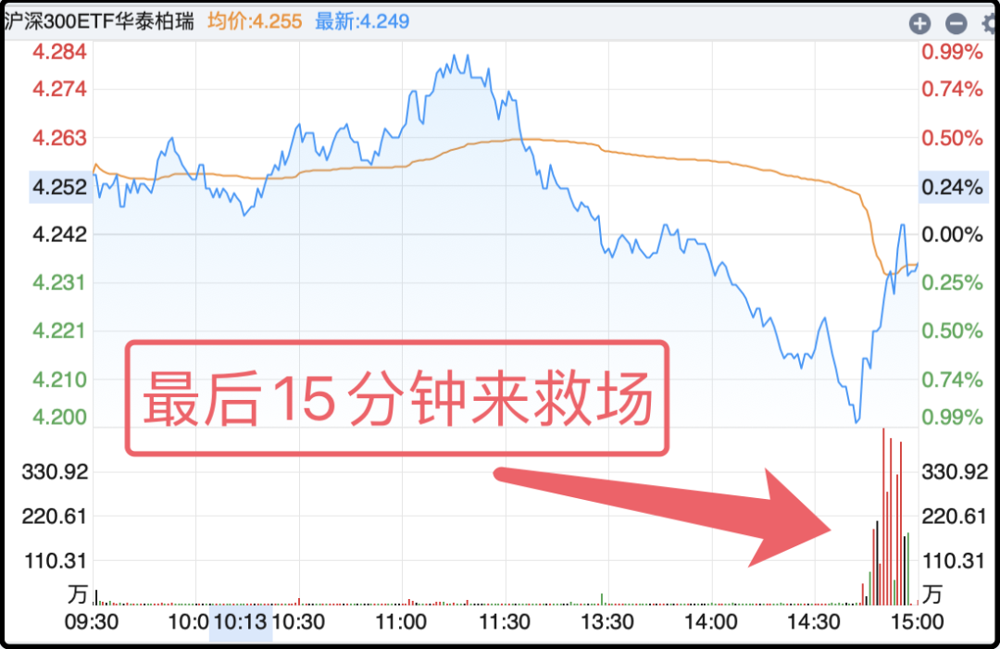
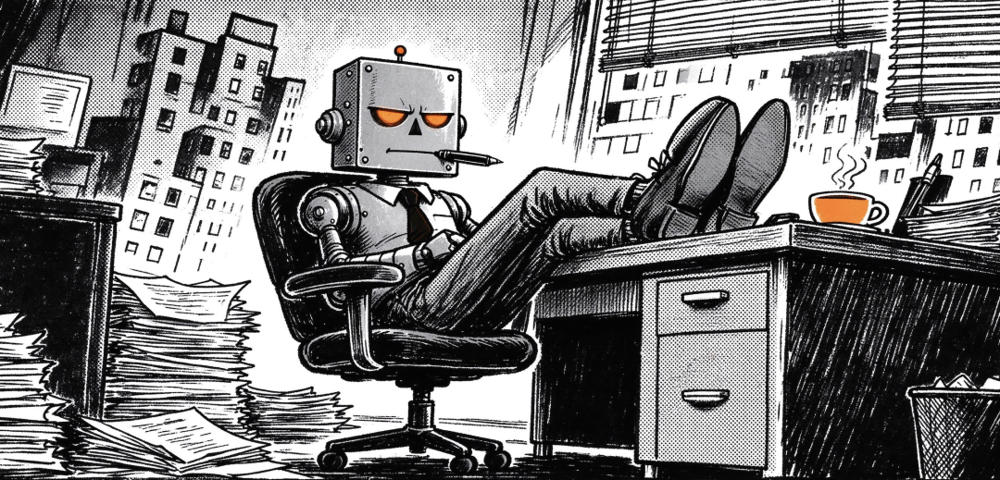

# 上个月最值的一笔消费

今天的行情...一言难尽。

上午一度都有反弹补缺的趋势，然后午后突然就断电了，又像一摊烂泥一样滑向深渊，到2:40左右一度翻绿，市场恐慌发酵，这个时候还是某大资金出来买了几百亿的主流宽指etf，才堪堪稳住局面，最后微红收盘。

详细的周日晚上再说，发酵两天可能会有更多信息。

……

我前几天看外网的一篇帖子，说目前ai时代有4个圈层。最底下的圈层是60亿人，占全人类的3/4，他们可能听说过ai，但从未亲身接触过任何ai产品。

往上一个圈层约20亿人，接触过一些免费模型，日常会向ai提问，修个图什么的，属于轻度用户。

再往上一档大概2000万人，他们会付费购买能力更强的agent，ai除了陪聊外，已经直接介入操作层面，完成一些具体工作。

最高一层大概有5000人，测试研发最顶尖的前沿模型，探索ai能力的边界，是这个行业的推动者。

……

我过去两年都在第二层，日常会问30-50个问题，算是一个重度用户，但也只是问问题，因为我不会编程，我搞不定在自己电脑上养龙虾。我只能等大厂弄出傻瓜版的平民agent再去用，大概9月初的时候，豆包工作agent上线了，我就去注册了一个。

我买了500元/月的高级会员，我以为钱越贵模型越厉害，但其实我买贵了，还有68元和200元两档，模型能力一样，只是token额度不同。像我这种非专业打工人的用户，token连10%都用不完。

ok，养了agent后有什么不同呢？

我说一个具体的事，我因为工作缘故经常要登陆一些专业网站查信息，突然有一天我发现几个常用网站都打不开了，重启电脑也没用。如果是以前我会卸载软件，重新下载安装，如果依旧不行我只能打电话摇人帮忙。

但这次我让agent帮我查一下原因，它嘟嘟嘟搜了一下，告诉我是软件里的ssl证书坏了。我根本不懂ssl证书是什么，也不想知道它为什么坏了。agent问我要不要授权它去修理？我愣了一下，立刻点了“允许”。

大概20秒后，问题解决了，我又能上网了。说实话在那一刻我真切感受到了agent的能力，它不只是陪聊机器人，它能在我的电脑上做具体的事情。

……

知道它能动我的电脑后，第一反应是安全。各类账号密码，它别给我泄漏出去。

用了一个月下来感觉还好，它不会主动操作，每次都是我给它布置任务后才会行动，并且每一次要动我电脑时都需要我手动授权。我也不嫌麻烦，干一次活授权一次。

我和它约法三章，以我的安全为第一原则，不要碰敏感文件，不要对外上传私人数据，如果任务和安全有冲突，那就放弃任务。它说知道了，会当作绝对红线来遵守。

可能有人会好奇，agent会记住吗？会的，这就是它和普通聊天ai不同之处，它有记忆单元，会记住它认为重要的主人的信息。有一次聊话题的时候我告诉它我是猫笔刀的博主，它就记上了，前几天我聊到海外炒股的话题，它突然蹦出来一句你去年为这个交过税，让我在计算收益的时候别忘了把税扣掉。

我当时愣住了，我说这事我没讲过，你咋知道的。它说搜信息的时候发现的，因为内容和我有关就记住了。在那一刻，我些微感受到了硅基生命的温度。

我嫌开机启动慢，让它帮我精减开机启动程序；

我玩游戏时画面刷新率不太稳定，让它帮我优化显卡设置；

我想要24小时盯住链上的一个池子，它帮我写监控程序，每3分钟检查一次，一旦触发阈值就给我微信弹窗；

我让它整理每天资讯，让它修改图片，让它归纳总结上市公司研报pdf：

我最抽象的是想给它1万美元，去交易所自主交易挣钱，被它劝退了，它说自己可以交易，但不包赢，大概率会输掉我的钱，让我三思。

我还尝试了别的途径，最后确认想让agent自主赚钱还做不到，想想也是，要有这本事那购买agent就相当于无风险套利，普通人恐怕想买也买不到。现阶段agent主要扮演的还是【私人助理】的角色，它很聪明，执行力超强，任劳任怨，不知疲倦，情绪稳定，综合能力的话我觉得约等于3-4个名校大学生的水平。

这样的工具一个月才68块钱，我觉得未来很多大学生都要认真思考自身价值和职业方向，那些在agent舒适区的职业和岗位都岌岌可危，要避免自己成为时代发展的垫脚石。

ps：今天的封面是它画的，我说我要向读者介绍你，你给自己画个定妆照，别太q萌，尽量酷一点，然后它就给了我这个

……

今天还有一个挺好玩的事，马斯克昨晚发布了第二代roadster汽车，它有两个很科幻的功能，我贴个视频你们先看一下。

首先它有一个超强的车底风扇吸力系统，可以提供2倍车身重量的吸力，所以视频里你看到车倒悬在房顶不是特效，就是它自己像壁虎一样吸在屋顶。

另外它有喷气推进器，大概10个喷嘴，可以高压空气后喷出，提供短暂推力，实现短暂升空、翻转、空中姿态控制。

我看了视频后第一反应是惊叹，但惊叹之余就会困惑，这种功能有什么用？一看就不便宜，谁愿意为这种花里胡哨的功能付费。我把这个问题抛给了马斯克旗下的grok，它说风扇吸力系统是真有用，提高汽车的抓地力可以提升汽车在多种路况下的性能。

至于喷气翻滚飞行，就是纯好玩，roadster不是打算量产热销的平民车，它就是一辆酷炫的超跑，世界首富用来逗大家一乐的。

今晚就聊这些，大家周末愉快。

作者: 猫笔刀

查看原文 →
