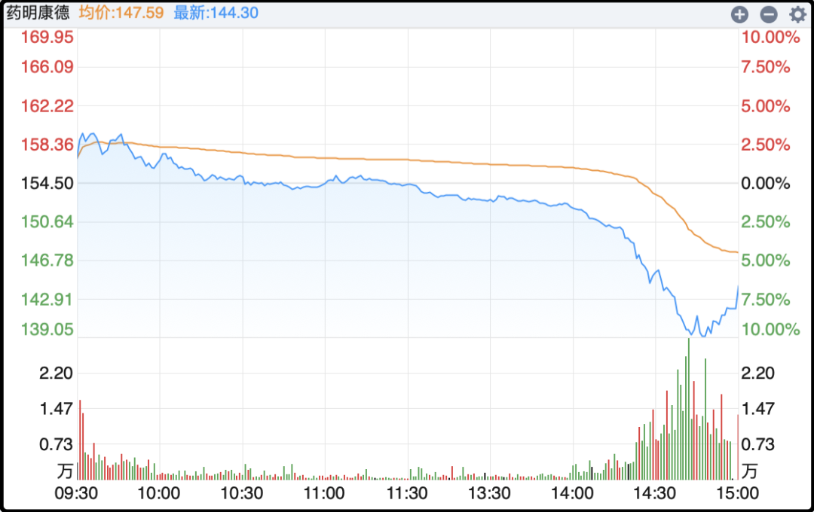
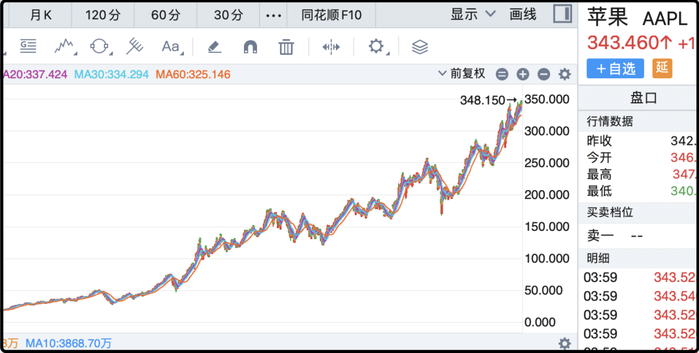
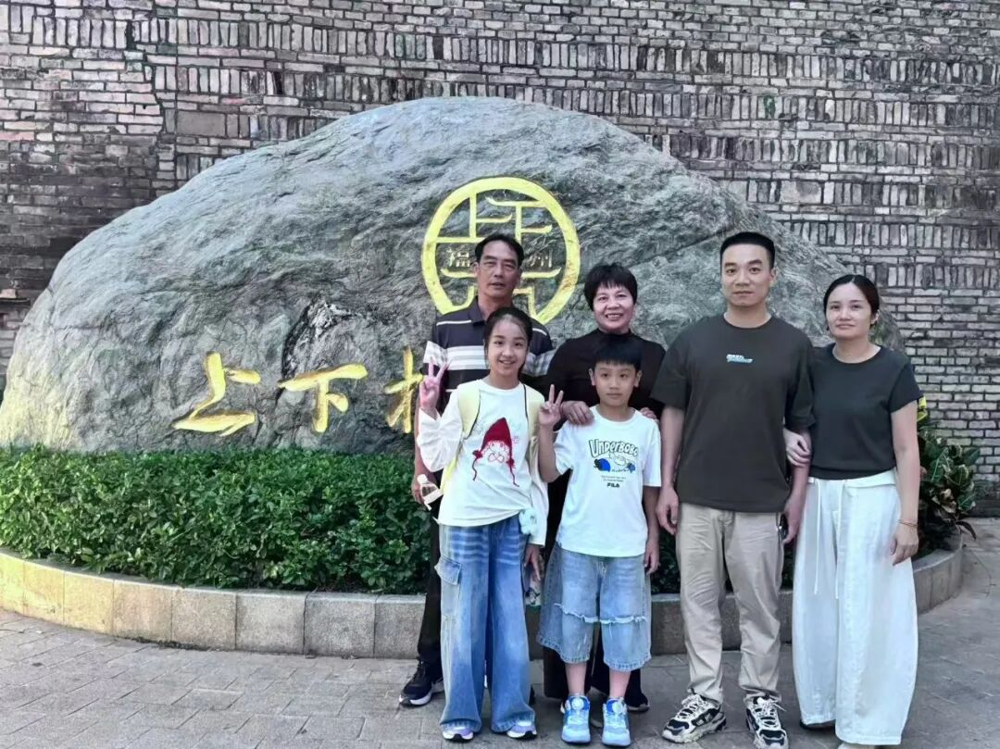

# 最后20分钟，又托了一下

明天要开盘了，把重要的事情简单捋一下。

1、周五行情波动巨大，上午持续反弹，午后突然断电滑坠，我事后复盘检查了一下并没有什么突出利空，应该就是目前处于下跌浪，市场信心不足，反弹到一定程度（刚刚接触5日线）就有人想跑路，跑的人多了就出现踩踏，场面一度十分难看。

最后还是某大资金（疑似是官军）进场维护了一下秩序，他们出资约160亿买入两个宽基指数etf，分别是沪深300etf（510300）买了约120亿，上证50etf（510050）买了约40亿，都是收盘前20分钟内操作的。

这看起来是某大资金连续两天在尾盘出手，比周四的规模要小，周四买了将近500亿，这次用160亿把指数拉红就收工了。行事风格倒是和前几年的很一致，会观察大盘表现，只在临收盘前干预调整，这样不会改变市场的整体走势，但会降低波动的烈度。

你不能觉得他们在这里连买两次就认定这里是官方认定的底线，以我前几年对官军操作的理解，他们对下跌的容忍度挺高的，他们只是不愿波动太大或者跌的太快，所以会用这类“点刹”操作来缓冲。

2、周五还有一个热点是药明康德的暴跌，下午临收盘前一度逼近跌停，当时有传闻说可能又是美国那边要掐药企的脖子，但收盘后的一则消息看起来是更主要的因素。

什么消息呢，商务部、科技部拟修订《中国禁止出口限制出口技术目录》，里面增列了部分人工智能（23项）、生物医药（5项）、光伏技术（12项）。创新药板块主要甲方都在美国，以前市场担心美国那边不让进口，现在这边还有不能出口的风险。

其实不单是创新药，所有做中美生意的企业都会面临双重政治风险，隔三差五就会黑天鹅飞一下。既然有额外风险那为什么还有那么多资金前仆后继呢，关键是真能挣钱啊，各行各业都想卖东西给美国。我之前和你们说过一个数据，改革开放以来，中国接近一半的外贸顺差是从美国那里赚的（40-45%），如果算上转口贸易的话这个比例会更高。

3、周末另一个大事是Anthropic的估值被下调了，消息源头是路透社援引4名知情人士，部分投资者把原先2万亿美元的IPO预期口径，下调至更务实的1.5万亿美元，整整少了5000亿美元，这也被视为ai热潮降温的重要信号。

下调估值的关键原因是营收增速放缓，他们一季度营收47亿美元，二季度营收116亿美元，都是100%以上环比增速，但是三季度167亿美元，环比增速45%，虽然依然是高速增长，但想象空间一下子就下来了。

另外Anthropic招股书写着，未来十年算力基础设施承诺至少5180亿美元，大部分合同不可取消，保底付费，不管你用不用满算力都要付钱，这种属于杠杆经营的操作也让市场颇为忌惮，万一ai商业前景不及预期就糟了。

Anthropic作为ai行业的龙头有着标杆作用，它的市值突然少了1/4对整个行业都有连锁反应。

4、前两天马斯克搞的roadster跑车喷气飞行令全球关注，但这车的量产计划最快也要2028年，考虑到马斯克惯有的跳票表现，我怀疑2028年未必能量产，所以别太当回事。这车有两个敏感问题，一个是成本售价，另一个是上路的合法性，汽车喷来喷去砸到其他人算谁的。我觉得这就是世界首富搞出来的一个玩具，纯粹好玩，没有大面积商业落地的空间。

5、长鑫科技前三季度预盈1310亿-1325亿，主要原因是DRAM供不应求，价格大幅上升。之前预期是一年赚1300亿，现在三个季度就赚到了1300亿，确实是一台很厉害的印钞机，但也架不住最近股价持续下跌，总市值前几天一度跌破3万亿。

长鑫刚上市的时候我说过理性估值不会超过3万亿，这是横向对比当时三星、海力士得出的结论，现在三星、海力士也在跌，所以这个理性估值也要进一步下调。长鑫有可能1-2年内都有流动性溢价，因为他们真正一批大规模的解禁要36个月以后，在此之前流通盘也就10%不到。3年后内存周期恐怕也结束了，所以这股不利远战，要有退出窗口期的规划。

6、苹果折叠屏手机热卖，瞬间售罄，黄牛在二级市场上加价5000-10000元。目前苹果折叠手机的产能有限，未来一年满打满算也就600万台，不及华为折叠屏的销量。

苹果股价最近连续刷新历史新高，巴菲特前几年大幅减持苹果的均价是185-195，毫无疑问卖亏了卖低了。苹果是巴菲特投资生涯最赚钱的股票，单股赚了1500亿美元。

……

今晚差不多就这些，最后依然是读者带父母旅游的展示：

“感谢猫哥的活动，运气爆表中奖了。由于工作原因只有两天假期，选择了自家的省会福州，两天一夜游，带了岳父岳母老婆孩子一起去了福州，逛了三坊七巷，打卡爱心树，看了名人故居，吃了福州美食，旅途圆满结束，顺顺！”

夫妻三十大几，家庭美满，有儿有女，这种算中国中产家庭典型样本，也是我读者群体的主流画像

上钟了。

作者: 猫笔刀

查看原文 →
