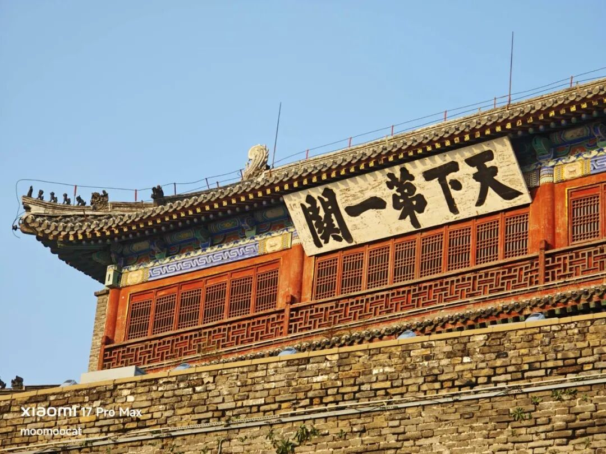
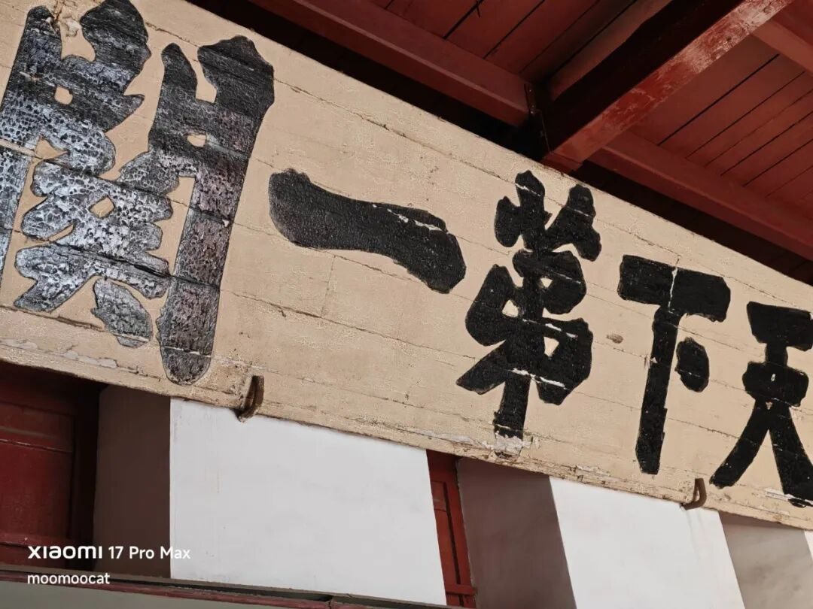
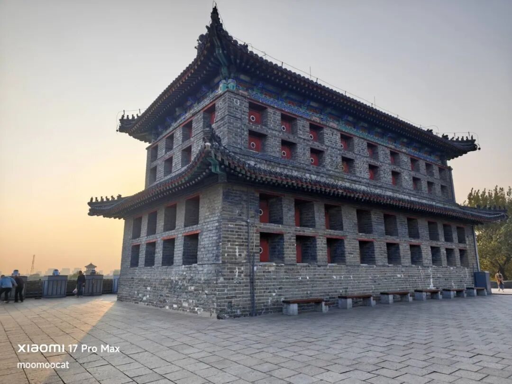
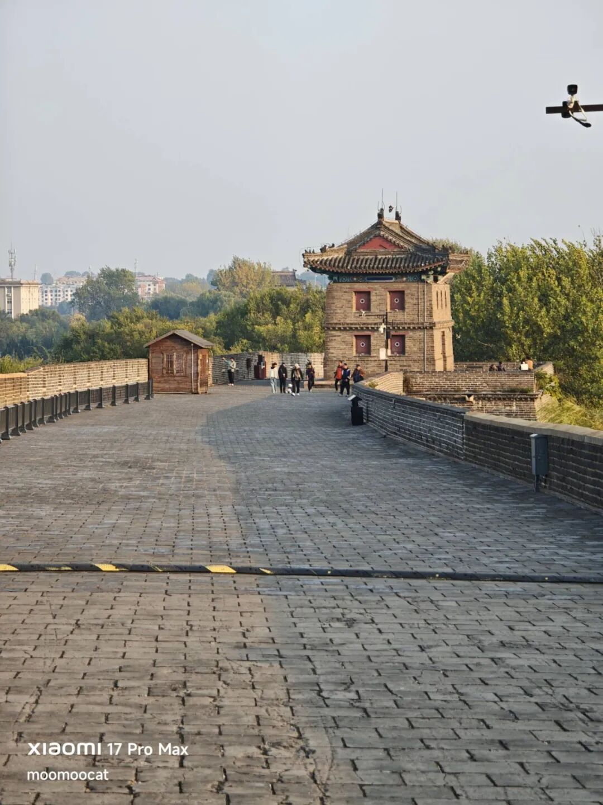

# 肾结石都震碎了

我发现一个挺邪门的事，每次我坐在火车上看行情，a股好像都挺能涨的。今天12点半检票的时候大盘还半死不活的，刚坐上火车行情就起来了，直接来了一波惊天大逆转。上午还-3%的，收盘直接干到+3%，一天内我期货+股票拉回来200多，有够刺激的......

类似的情况发生过好几次，以至于我脑子里逐渐有个条件反射，就是在火车上看行情总有好事发生。坐飞机就不行，飞机没网看不了手机。

古人的玄学就是这样产生的，有次三天没撸去赌博赢了，回来总结就会觉得戒撸可以提升赌运。为了不影响大盘，也破除迷信，我决定以后出门来回坐火车都选在周六周日，不能让a股占我便宜哈哈哈。

不管怎么说周五涨确实好，涨一天高兴三天，四舍五入这周算一半时间都在上涨了。我的小助理从去年开始就想上车1手ic，我一直觉得时机不好让她等等，直到前天我跟她说值博率可以了，她一天就把账户开好，钱也转进来了。今天一涨她问我要不滚2手，被我坚决制止了。剧烈波动的股市，真的很容易孕育激进的赌狗

关于行情周日晚上再细聊，一些信息也让周末再发酵发酵。

……

我这两天带我妈来山海关玩，我最近在重看晚明史，看到一片石战役，心想山海关离北京那么近，正好溜达过去看看呗。

我先给你们讲一段故事吧。话说李自成率军攻破北京城，崇祯皇帝煤山上吊，大量明朝将官都来归降大顺政权。这个时候吴三桂率领关宁军驻守山海关，具有极高战略价值，李自成很重视，派了唐通去劝降，许诺封侯。

吴三桂一开始同意了，让唐通接防山海关，自己去北京觐见李自成。山海关离北京300公里，古代要走4-5天，结果吴三桂半路上遇到了自己家逃出来的奴仆，说大顺军的刘宗敏把吴家给抄了，把吴三桂父亲吴襄给抓了，把吴三桂爱妾陈圆圆给抢了。

我看到这一段史实的时候直接懵了，难以置信刘宗敏会有这种智障操作。李自成让他在北京城搞钱，他爆官员士绅金币无可厚非，但像吴家这种在边关手握重兵的总得特殊对待吧。大概真就是农民起义，泥腿子一朝翻身，没啥政治格局，军队纪律太差，见人就抢，结果酿成大祸。

吴三桂知道消息后肯定反了，马上回山海关把唐通打跑，然后就旗帜鲜明的反抗大顺政权。李自成和刘宗敏率领6万精锐部队攻打山海关，关城设计是防外不防内，吴三桂的关宁军伤亡惨重，眼看就要崩溃落败，吴三桂亲身去多尔衮军营求援，多尔衮开出条件，必须投降满清，剃头留辫子，吴三桂答应了。

第二天吴三桂偷偷打开城门，放满清军队入关，从侧翼突袭，李自成军队猝不及防被彻底击溃。这一路追杀死伤殆尽，最后逃回北京只剩6000左右，损失了90%。

死掉的这批人是李自成打天下的核心骨干，真正意义上的百战精兵，就在山海关这里一仗输光，输掉的还有大好江山，满清自此入主中原，统治近300年。

城楼上的“天下第一关”牌匾是1920年重修时复制的，原品在关楼内（下图），明朝时留下来的。没有题款，所以至今不能确认作者是谁。比较主流的说法是肖显（进士，山海关本地书法家），但也有说是奸臣严嵩写的。

我发现只看景区照片很难理解山海关地理的战略价值，我决定掏出手机来给你们录一个讲解视频。

……

清朝后山海关作为军事要塞的价值就没有了，因为当初要防的敌人入主中原了。不过此时山海关有了新的用途，满清觉得东北是他们的龙兴之地，禁止汉人进入东北，所以山海关就成了扼守东北的门户。

一直到晚清政府被列强暴打，俄罗斯、日本都对东北虎视眈眈，清政府发现只靠八旗那点兵根本守不住，必须让大量老百姓填充东北才能防止外国渗透。于是开放了东北移民，大量河北、山东农民掀起一波“闯关东”的浪潮。

今晚就聊这些，上钟了。

作者: 猫笔刀

查看原文 →
