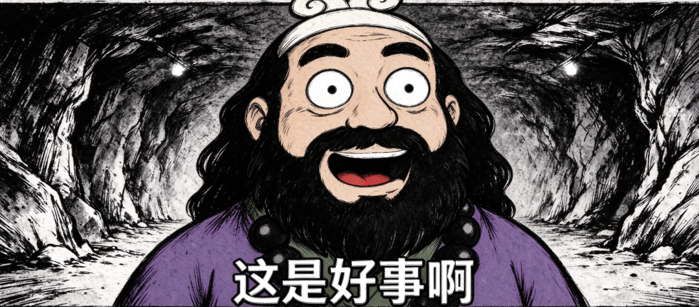
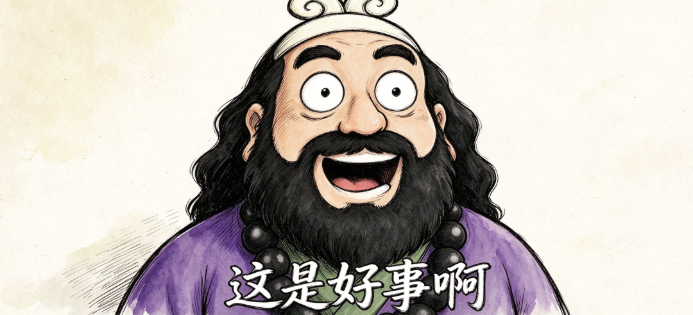
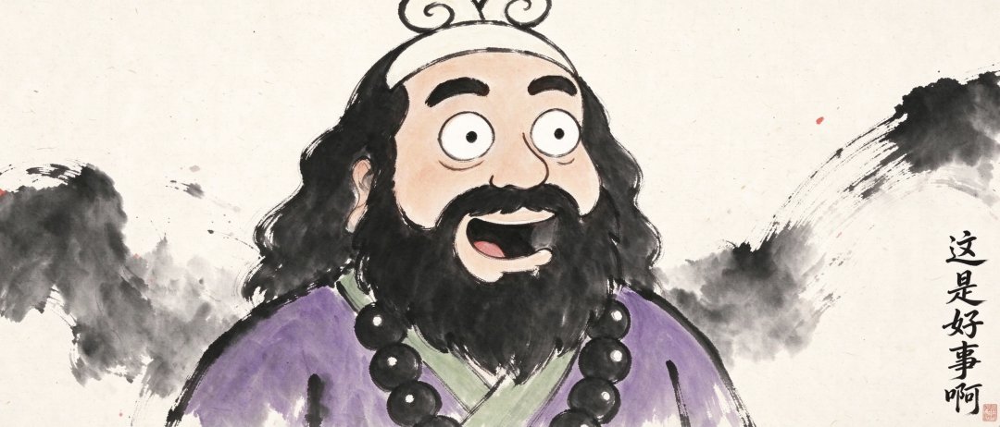
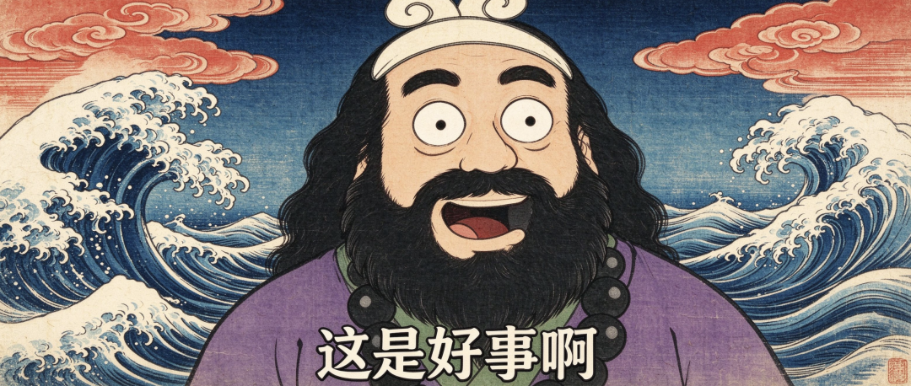

# 这是好事啊

我最近都用agent来生成封面，已经不再花钱买画了，毕竟行情不好，能省一点是一点。

一口气能出黑白地下风，复古版画风，美联社风，中国水墨画风，波普艺术风，赛博朋克风，浮世绘风，都是我默认的长期偏好。

感觉以后插画师的职业空间真的很小了。

阅读 10万+ · 赞 7212 · 原创 · 图文 · 组内第 1 篇 · 数据采集于 2026-11-20 12:26

查看原文 →
