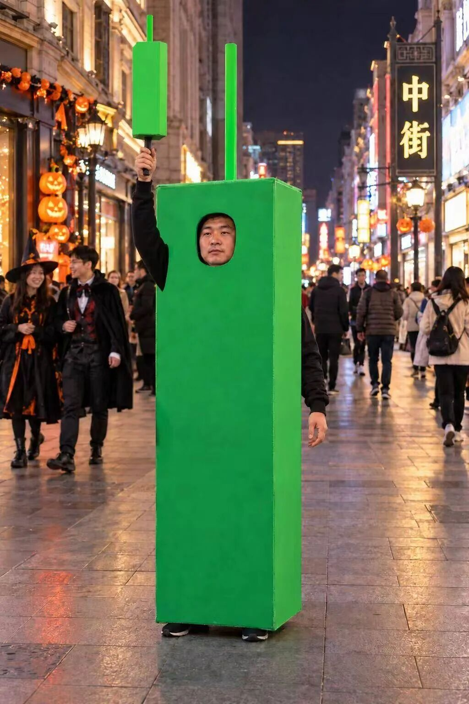

# 啊对对对

今天是周末，也没发生啥大事，我就想到哪写到哪，挑一些轻松的随便聊聊。

我这两天刷到好几个孙宇晨的采访视频，就是爆料景甜的那个人，我发现他在接受采访时的口头禅就是“你说的对”、“啊对对对”，网友调侃说这是【肯定型人格】。

就是无论你说啥我都先肯定你，就算有不同意见先肯定你，后面再通过但是、然而、转折且委婉的提出来，这是一个很积极的沟通习惯，会大幅提高效率，减少摩擦。

我这两天还看到一句话印象很深刻，说如果你和一个人相处觉得很愉悦，如沐春风，那就说明这个人的情商比你高。两个人相处时，情商高的会持续给对方提供情绪价值，久而久之身边的人都会喜欢和他社交，也就是人缘好。

和孙宇晨相反的是段永平，我之前看过方三文采访他的视频，他在里面很频繁的否认或者反驳，“啊不对，不是”。通常名人之间对谈都是话赶话，商业互吹，像他那样较真的不多见。我这里没有说段永平故意抬杠，但总之他有不同意见就会立刻表达，不会为了照顾对谈的氛围而妥协。

孙宇晨和段永平都是成功人士，人生赢家，他们无论怎么说话身边都有人捧着，但对普通人而言好好说话其实挺重要的。就比如我，这些年强迫自己改掉了一个习惯，就是尽量、尽量不用反问句，都改为陈述句。

比如“你觉得你这样做的对吗？”，我会说“我觉得你这样做不合适”。

比如“有你这么干的吗？”，我会说“你这样做我觉得不行”。

反问句天然自带攻击性，从沟通效率上没啥帮助，只会搓火激化矛盾。有时候对方情绪激动，但看到你持续心平气和的表达，ta也会慢慢恢复理性。

我文章的划线评论区我也经常看，天南地北的网友聚到一起讨论，其实情商高低差距也很明显的。有些读者说话得体好听，大家就喜欢点赞，有些人发言很有攻击性，经常会吵起来。我当时就在想这样的人现实中大概也会磕磕碰碰，自己给自己增加难度。

……

这几天台州临海在举行柴古唐斯越野跑比赛，因为很多亲友点赞推荐，我在视频号上连轴转刷到相关视频。其中有一段女选手下坡的冲刺给我看傻了，我贴上来你们也感受一下：

这也太猛了，我从山上滚下来都没这么快

搜了一下这位是50公里女子组冠军，世界积分第一的瑞典名将tove，她这次完赛成绩是4小时25分，比第二名快了半个小时，太离谱了。哪怕给她并到男子组，这个成绩也能排第5。

你们可能会好奇，按照这个速度爬山下山，不会发生摔滑吗？其实也难免的，tove在这次比赛里摔了好几次，跑到终点的时候她的双膝都在流血，手臂也被划伤出血，上半身都是泥泞。

我自己是个废物，像这种强度的山路别说50公里，5公里我就累坏了，但我很喜欢看运动员在比赛里拼搏，尤其是这种有钢铁意志挑战极限的女超人，看了真是让人肃然起敬。

哦对了，柴古唐斯是临海土话，意思就是柴给你吃饱，狠狠收拾你。

……

今晚是万圣节，欣赏一组股民的演出吧。我也是从网上看到的，侵权的话联系我就删了。

今晚就这些吧，发了。

作者: 猫笔刀

查看原文 →
