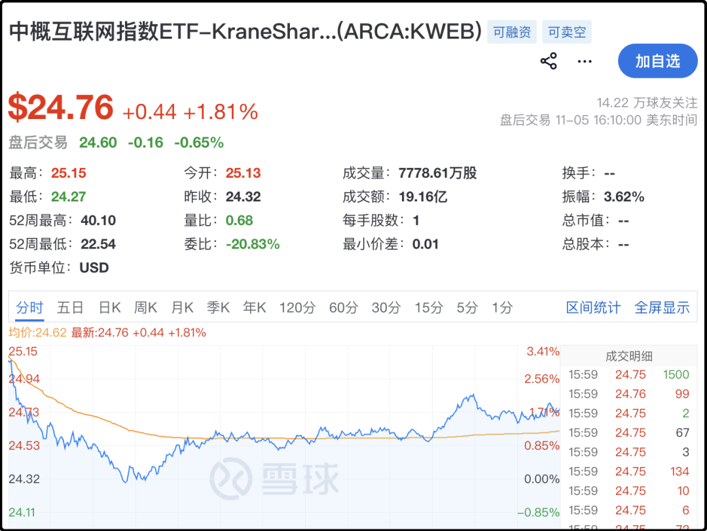

# 一大早手机都炸了

微信上叮叮当当的都在问美股昨晚大跌4-5%，a股会不会崩，咱们这边是不是糟了，要不要开盘秒跑。

我掏出手机看了会行情，确实形势有点严峻，但也没到天塌了的地步。首先中概互联网指数ETF(KWEB)昨晚这泥沙俱下的盘面里，它竟然是涨的你敢信...虽然之前烂到家了，但昨晚中概股确实支棱起来了。

新加坡a50期货从昨天收盘到现在跌了1.8%（从13017到12793），跌幅没那么夸张。这波是美国政治局势动荡冲击的ai科技，主要是他们那边自己的问题，我们最多间接影响。话说他们之前那么能涨a股也没跟啊。

高开的a股基本没好事，低开的a股往往有惊喜，我觉得可以期待一下，再说了队伍后面还有官军压阵，我寻思出不了大事。我没有跑路打算，真跌了我按我之前的计划执行。

随口就说这几句，希望心慌意乱的读者们稳一稳，我回去睡回笼觉了。

（这条不算群发，谁看到谁有缘，晚上正常更新）

赞 14386 · 原创 · 图文 · 组内第 1 篇 · 数据采集于 2026-11-11 22:37

查看原文 →
