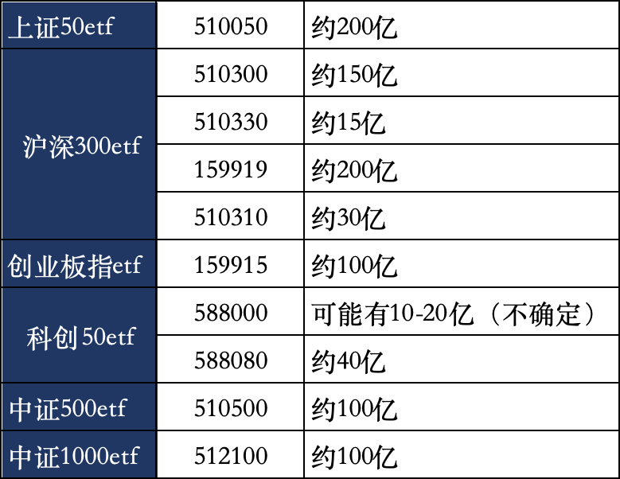
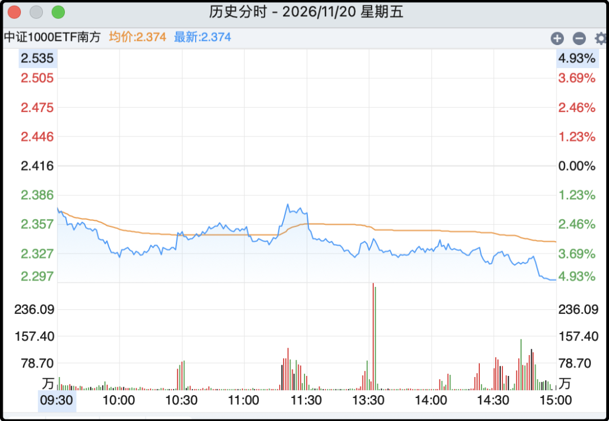

# 买了1000亿也没用

今天下午有个事还挺心酸的，我当时捧着手机在床上看行情，看着看着有些困了，就眯了会。可能因为这几天对a股行情想的比较多，我竟然顺着现实世界做了个梦，梦里面a股下午略有小反弹，最后普遍收跌1-2%。我虽然很无奈但也平静接受了。

然后就是我3点15分左右醒了，因为梦里面我也躺在床上看手机，醒来后手机就在枕头边，我一时间有些恍惚，分不清刚才是梦境还是现实，就拿起手机又看了一遍行情。

好家伙，现实比梦境版本可血腥残酷太多了，真够狠的。

今天官军上强度了，几乎已经是满火力模式，我复盘统计了表格。你们可以自己去各个etf的分时线上验证，量柱特征非常明显。

全部加起来大概单日1000亿，这没啥可说的，今天官军尽力了，但a股局面已经彻底失控，想要在今天这种情况下力挽狂澜，我预估可能需要单日打出去3000-5000亿，就算是国家出手也不能这么任性。

今天很多人留言问我，到底怎么了，官军全力护盘也跌得这么惨？就是跌太快，恐慌盘+止损盘+爆仓盘一起释放，抛压太大接也接不住，场内资金都被亏怕了，纷纷作壁上观，只有官军一个人冲进场内开大，等大招开始冷却就被暴打。

你们看中证1000分时线，全天只有官军集火买入的那几分钟能稍微扑腾一下，官军一停就往下掉，这股市它已经不是病了，它是昏迷了好嘛，搀扶的手一松开它就倒。

谁要为今天的a股负责我不清楚，但肯定不是散户，他们是最惨也最弱势的群体，他们在这个市场扮演的纯粹炮灰角色。也许很多制度和规则从一开始就设计错了，导致这条路越走越偏。

我前几天和agent探讨过中美股市差距，两边的指数年化回报率差了10%。agent总结出4个原因：

1、a股股本扩张太快，也就是俗话说的长胖不长个，大概导致了4%的差距；

2、美股注重回购反哺市场，a股重融资轻回馈，这里差距大概3%；

3、美股治理透明，政策稳定，这里差了2%；

4、美股能有效淘汰劣质上市公司，a股好吃难拉，这里差了1%。

四三二一，加起来就是10%。

我今天又加了一手，累计24手，仓位68%。我今天也私底下问过自己，是不是对a股的预期应该更悲观一些，调低买入区间，但反复思考后我还是坚持了之前的判断和计划。

最近几天真的有泥沙俱下的感受，我也在不断调整自己的预期，从牛市调整，到牛市终结，到过度震荡区间，再到a股转入熊市，最新我已经接受可能会发生局部系统性危机的情况。不到半年的时间内完成这一系列的转换，我觉得自己就是个精神病患者，但只有这样才能融入a股这个大型精神病院。

我知道很多股民这周经历了炼狱级别的体验，但周末还是要给自己放松和解压，该吃吃该喝喝该睡睡，股市只要没最终退出，所有经历都是过程。上半年的拥挤贪婪不是常态，现在的恐慌踩踏也不是，少数人在顶部和底部交换财富，大部分人就是坐了一趟疯狂过山车，体验很差还没钱赚是真的。

就这样吧，明天我要回趟台州老家，后天参加妹妹婚礼，之后要带家里老人出门旅行一趟，再回北京就是7天后了。希望我坐火车的时候行情真的能好一点。

作者: 猫笔刀

查看原文 →
