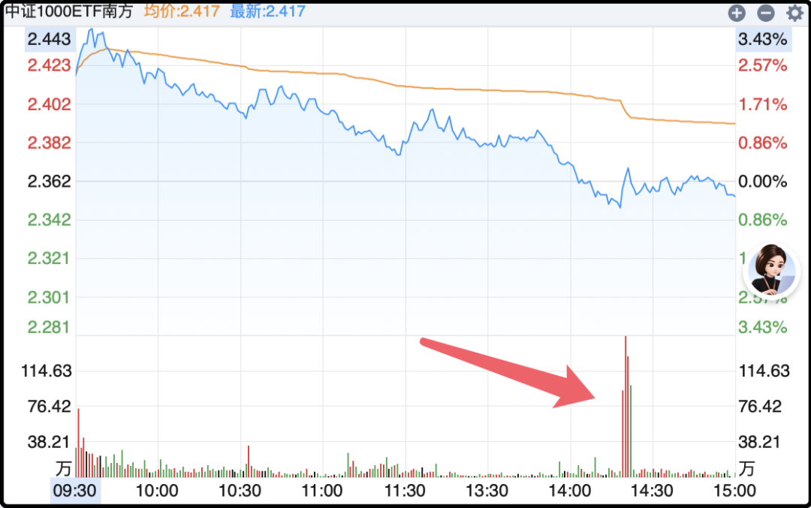

# 又来又来又来又来

高开就低走，祖训有没有。多头干瞪眼，空头喝小酒。

高开又低走，谁冲是傻狗。九点半上头，收盘愁上愁。

今早从临海出发，坐了9小时高铁到张家界，一路上就看着a股刺溜刺溜往下滑，创业板指从+4%到-0.13%，中证1000从+3%到-0.23%，还是熟悉的配方，熟悉的味道。

英伟达高开20%能涨到30%，我们高开2%都要跌回去，这盘面还有人类啊？我今天问agent为什么a股高开总是撑不住往下砸，它觉得核心原因a股是存量博弈，缺少增量资金，所以每次利好兑现都是抢着出货，手快套现，手慢站岗，等下一批脑热上头的韭菜。

a股扫兴是真扫兴，但终究还是只能原谅，然后继续炒。要是几个月前你不高兴一键清仓，拍拍屁股走了，现如今跌都跌透了，低位都不舍得割肉。所以都说欠钱的是大爷，a股现在就是股民的大爷。

美股在经历了昨晚的“黄仁勋狂欢”后，今天也开始理性冷却，英伟达盘前下跌5%，回到了上周二的位置。ai板块虽然短线修复了情绪，但针对超前定价的清算还没有完全结束。

映射到a股就是科技板块后续还会有震荡拉扯，想要重启上涨做不到，现阶段能稳住阵线，不要跌破周一低点就算成功。大家往好处想，至少已经不会有连环爆仓的系统性风险了，最差就是科技牛市白涨，一切回拨到之前的熊市继续装死。

今天官军只少少买了一点，下午中证500和中证1000这对恰屎兄弟跌的实在不像话的时候兜了一下，还有沪深300尾盘象征性捞了一点，全部加起来不到百亿，基本还是让市场自己走的。

……

1、今晚很多人都在传一条消息，说美国准备对数十个国家提高关税，新一轮的贸易战即将打响。这事确实不是什么好消息，但不是突发利空，它是3月份启动的301条款产能过剩调查的结果，市场之前就已经有过相关定价。

它是原有关税框架内调整，附带豁免通道，而且美国现在通胀压力大，在对中国加税这件事上投鼠忌器，真实冲击没有那么大。主要是a股最近跌怕了，无论听到什么坏消息都容易在情绪上放大，所以才搞得大家人心惶惶。

2、今晚还有另一个坏消息落地，欧盟计划从12月1日起对混合动力汽车实施年度进口配额，明年上限是35万辆，之后每年递增6%，执行期4年。

我查了一下去年中国出口到欧盟的混动车数量是30.2万辆，但是，但是，但是，今年我们出口增速暴增，前面7个月就已经37.8万辆，全年预期是80万辆，所以如果明年限额只有35万辆的话会有五六十万辆汽车被拦在欧盟之外。

我们国内汽车市场今年明显下滑，现在全靠出口外销消化产能，欧盟这个时候卡一下会很难受。接下来商务部和外交部会和欧盟battle，如果协商失败不排除去世贸打官司的选项。

中国电动车产能爆太快了，快到国内卖不完，国外也吃不消，之前的光伏也是，产能多到全世界都用不完，这又是何苦来哉。不要那么拼，都停下来缓一缓，挣点钱，消费消费，享受一下多好啊。

今晚我刚到酒店，内容比平时短点多包涵哈，明天就要带700岁老年团粗发游玩了

作者: 猫笔刀

查看原文 →
